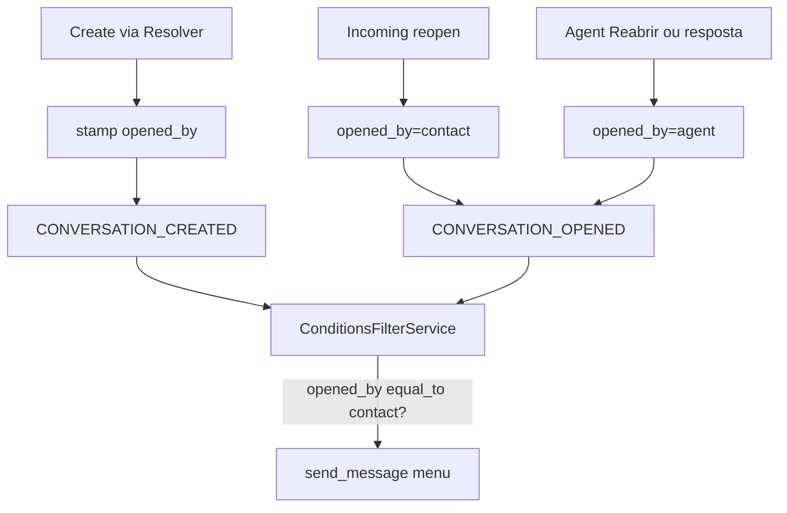

# Automation `opened_by` — Documentação

Condição configurável nas regras de **Automação** para filtrar por **quem abriu** o episódio atual da conversa (`contact`, `agent` ou `phone`). O menu de boas-vindas deixa de sair quando a empresa inicia pelo WhatsApp Web/celular ou o agente reabre.

**Estado:** implementado · revisão out/2026

| Área | Status |
|------|--------|
| Persistência `additional_attributes['opened_by']` | ✅ |
| Stamp na criação | ✅ contato (WhatsApp, e-mail, Telegram, SMS, Line, Twilio, Instagram, Facebook, TikTok, Twitter, widget, API pública, voz inbound), agente (dashboard, voz outbound, fluxo, Twitter da conta), phone (sync / echo) |
| Stamp na reabertura | ✅ incoming, agente (Reabrir e resposta outgoing), Wavoip, ciclo pending Evolution, celular em resolved/snoozed com histórico único |
| Condição na Automação (UI + backend) | ✅ `conversation_created`, `conversation_opened` e `message_created` |
| Filtro da lista, fluxo e relatório ao vivo | ✅ |
| i18n en + pt_BR | ✅ |
| Specs custom | ✅ stamper, tracking, condição, agent start, outgoing, phone sync, widget, API pública, canais, backfill e filtro |
| Migration / coluna nova | ❌ desnecessário |
| Backfill de conversas antigas | ✅ sob comando `rake opened_by:backfill` — não roda sozinho |
| Expor em todos os eventos de automação | ❌ só created, opened e message_created |

---

## Por onde começar

| Perfil | Documento |
|--------|-----------|
| **Visão / status** | Este README |
| **Regras de negócio** | [business-rules.md](./business-rules.md) |
| **Estado do código** | [current-state.md](./current-state.md) |
| **Por que esta abordagem** | [implementation-decision-tree.md](./implementation-decision-tree.md) |
| **Plano as-built** | [implementation-plan.md](./implementation-plan.md) |
| **Próximos passos** | [improvements-backlog.md](./improvements-backlog.md) |

---

## Problema

Regras de boas-vindas em **Conversa Criada** / **Conversa Aberta** disparavam para qualquer abertura:

- Origem inicia pelo WhatsApp Web/celular → menu
- Agente clica **Reabrir** → menu
- Contato inicia → menu (único caso desejado)

Não havia parâmetro nas condições para o admin decidir.

---

## Solução (resumo)

1. Gravar `opened_by` = `contact` | `agent` | `phone` no episódio atual de abertura.
2. Expor a condição **Aberto por** só em `conversation_created` e `conversation_opened`.
3. Admin adiciona `Aberto por` = `Contato` nas regras de boas-vindas.



`conversation_opened` só dispara quando o status passa a `open`. No ciclo Evolution com `conversation_pending`, a primeira mensagem deixa a conversa `pending` (`conversation_created` / `conversation_updated`); o evento **Conversa Aberta** sai na segunda mensagem do contato, já com `opened_by=contact`.

---

## Decisões fechadas

| Tópico | Decisão |
|--------|---------|
| Persistência | `conversations.additional_attributes['opened_by']` (sem migration) |
| Valores | `contact` · `agent` · `phone` |
| Uma chave | `opened_by` na criação **e** reabertura (quem causou o episódio atual) |
| Eventos na UI | Só `conversation_created` + `conversation_opened` |
| Regras antigas | Sem a condição = comportamento inalterado |
| Conversas sem stamp | `equal_to contact` não casa (seguro para legado e canais ainda sem hook) |
| Ausência na leitura | Não inventar `contact` |
| Fork | `custom/` + `# FORK:` mínimo (`Current`, `filter_keys.yml`, `Resolver.prepend_mod_with`, constants FE, prepend do widget e da API pública) |

---

## Go-live / uso operacional

1. Hard refresh no dashboard depois do build dos assets.
2. Editar regras **boas vindas (Conversa Criada)** e **(Conversa Aberta)**.
3. Adicionar condição: **Aberto por** → **Igual a** → **Contato**.
4. Smoke: origem WhatsApp Web (não envia menu); Reabrir agente (não envia); contato inicia (envia).

Inspecionar no console Rails:

```ruby
Conversation.find_by(display_id: 40, account_id: 15).additional_attributes['opened_by']
```

---

## Índice

| Documento | Conteúdo |
|-----------|----------|
| [business-rules.md](./business-rules.md) | Quem é origem/destino; quando stamp; quando filtrar |
| [current-state.md](./current-state.md) | Mapa de arquivos, hooks, limitações |
| [implementation-decision-tree.md](./implementation-decision-tree.md) | Opções avaliadas e vereditos |
| [implementation-plan.md](./implementation-plan.md) | Fases as-built, arquivos, testes |
| [improvements-backlog.md](./improvements-backlog.md) | O que ainda falta |

---

*Última atualização: 2026-10-24 — episódio pending de phone/agent não vira contact; create do agente ignora `opened_by` do cliente*
