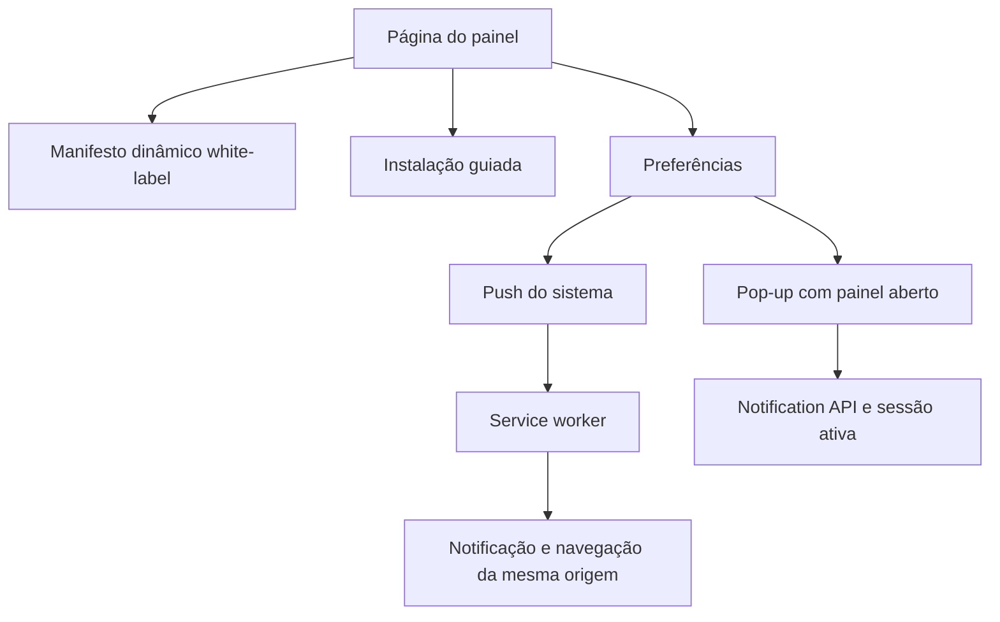
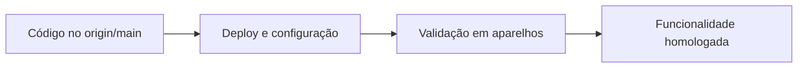

# PWA — decisões de implementação

## Separação de responsabilidades

Push e Pop-up não são equivalentes. Push usa inscrição, serviço do navegador e worker, e pode funcionar com a página fechada. Pop-up usa a página ativa e a conexão em tempo real. Por isso, conceder permissão a Pop-up não cria inscrição Push, e a permissão do dispositivo não substitui a seleção de eventos por conta.

## Manifesto e identidade

- O manifesto fica em `custom/` porque nome e ícones variam por instalação. `/manifest.webmanifest` é canônico; `/manifest.json` é só alias, sem arquivo estático concorrente.
- `id: "/"` preserva a identidade das instalações antigas. `prefer_related_applications: false` declara a preferência pela PWA.
- Link e metadados mínimos ficam fora de `DISPLAY_MANIFEST`, que continua controlando só os metadados padrão do Chatwoot.
- Ícones regulares são `any`; os adaptativos separados são `maskable`. Sem os maskable configurados, o manifesto preserva a entrada anterior `any maskable`, para não quebrar instalações existentes. Ícones novos usam URLs novas por causa do cache longo.
- `mobile-web-app-capable` e `apple-mobile-web-app-capable` ficam juntos para compatibilidade entre Chromium e Apple.

## Instalação

- Evento disponível e sem erro verificável → prompt só após clique, consumido antes de aguardar para não perder um evento novo. Sem evento → instruções; não inferir instalado nem incompatível. iOS não tem o evento; o fluxo nativo do Safari é ensinado. Navegador integrado → copiar o endereço e orientar Chrome/Safari.
- Consulta de instalação pendente → **Verificando**, sem consumir o prompt. Dez segundos sem conclusão → abortar requests, informar timeout e oferecer retry somente por clique.
- JSON, campos ou ícone inválidos → erro de configuração; rede ou HTTP 5xx → erro de conexão. Ambos bloqueiam a instalação direta até uma consulta válida, sem concluir que o navegador é incompatível.
- Manifesto válido não garante o evento: a decisão final é do navegador e do aparelho.
- Standalone ou `appinstalled` → ocultar a promoção. Dispensa persistida → não reapresentar automaticamente, sem esconder as preferências.

## Ciclo Push

- **Opt-in local e serializado.** Não transformar permissão já concedida em inscrição contra a escolha do usuário; cliques concorrentes não podem produzir inscrições duplicadas.
- **Registro correto antes de `subscribe()`**, com limite de dez segundos; `ready` de outro escopo não basta. Worker registrado com `updateViaCache: "none"`.
- **Sessão como fonte de cancelamento.** Logout invalida a geração e aborta requests; cada etapa assíncrona confere a sessão. Não usar apenas uma corrida de Promises, e não deixar a limpeza esperar numa fila. Falhas são sanitizadas e não impedem o logout. **Logout não é opt-out:** só desativar grava `false`, e só em `chatwoot:push-enabled:v1:<uid>`. O `false` antigo é ignorado, porque não distingue logout de recusa; o `true` antigo ainda vale como opt-in. A chave antiga não é apagada. Quem já ficou com o `false` antigo recebe um convite único de recuperação (`chatwoot:push-recovery:v1:<user_id>`) se a permissão segue concedida e o aparelho não está inscrito. **Agora não** não grava preferência. Se o navegador omite `applicationServerKey`, a inscrição só é recriada quando `chatwoot:push-vapid:v1` existe e difere da chave atual.
- **Retomada sem polling.** Revalidar permissão e inscrição ao voltar ao primeiro plano.
- **Convite próprio** só na primeira abertura autenticada da PWA instalada; solicitação nativa exclusivamente após clique; sem repetição após **Agora não**; armazenamento indisponível suprime o convite para não insistir. Inscrito ou opt-out → sem convite. Bloqueado → instruções, nunca promessa de desbloqueio. Retorno ao app reavalia o estado.
- **Ambiente indisponível com motivo.** HTTPS inseguro, APIs ausentes e VAPID ausente são motivos distintos dentro do contrato `unsupported`; não são permissões negadas.
- **Aviso de zero eventos** só com inscrição confirmada, consulta da conta bem-sucedida e nenhuma gravação em andamento. Nunca ativa eventos por conta própria.

## Teste do dispositivo

- Fluxo: leitura fresca de ambiente/permissão/opt-out → inscrição confirmada pelo helper → envio ao endpoint confirmado.
- Negada → ajuda; pendente → CTA que pede permissão; iOS fora da PWA → instalação; opt-out → ativação explícita; incompatível → limitação, não bloqueio. Recuperação ou ativação só viram teste após novo clique.
- Aceito → perguntar ao usuário. **Não recebi** → conferir novamente sem reenviar.
- 404 → recuperação explícita e outro clique; 429 → aguardar (no máximo três testes em 60 segundos corridos, sem rajada extra na virada do minuto); 401/403 → sessão/autorização; 422/502/rede/timeout → cadastro, envio ou conexão.
- Diálogo fechado → invalidar a apresentação anterior; o envio já iniciado pode chegar, mas sua resposta não reabre o diálogo.
- Resultados existem só no frontend: sem telemetria de banner, sem credenciais no worker, sem endpoints novos além do `test`.

## Entrega e banner

- Inscrição recusada por autenticação → preservar e diagnosticar; inválida ou expirada → remover, depois de gravar `expired`. Logs e `last_push_error` só com provedor, HTTP e motivo de uma lista permitida.
- **Podar inscrição órfã aos 60 dias**, não antes: some quem não sincronizou e não recebeu envio aceito nesse prazo. Envio aceito recente preserva a linha mesmo com sincronização antiga. Não tocar FCM. O aparelho com preferência `true` se reinscreve sozinho.
- Texto longo → reduzir apenas título e corpo para caber em 3.900 bytes, preservando UTF-8, destino e destinatário. Metadados excessivos falham explicitamente.
- Payload inválido ou falha da apresentação normal → aviso genérico mínimo; falha final continua erro. Nada de Push silencioso nem repetição indefinida.
- Som ou aviso sem banner → orientação do sistema após conferência fresca. Nenhum reenvio ou pedido nativo automático.
- A urgência do Web Push não é a importância de uma categoria Android. A PWA não pode forçar banners, alterar Banners/Foco do iOS nem garantir apresentação.

## Segurança

- Revalidar acesso e preferências no job evita expor conteúdo após revogação; validar browser Push antes do builder evita dados inválidos e transferências parciais.
- Diagnóstico e leitura herdam autenticação/MFA; o teste só envia ao próprio endpoint browser e não cria notificação real.
- O worker não recebe credenciais nem chama APIs autenticadas. **Marcar como lida** usa um nonce de uso único de até 60 segundos; o frontend espera a sessão, consome a intenção e confere conta e destinatário. Sem login ou após expirar, não há escrita automática. A ação abre a caixa de entrada para não ler outras notificações via last-seen da conversa.
- No clique, URL externa ou inválida é substituída pela raiz da própria origem; só janelas `/app` da mesma origem são reutilizadas.

## Extensão do fork

Lógica específica em `custom/`; controllers e serviços Ruby via `prepend_mod_with`; arquivos upstream com apenas hooks e imports `FORK:`. Isso reduz conflitos ao sincronizar com novas versões do Chatwoot.

## Integração, disponibilidade e validação

Releases de código no host não devem separar os uploads persistentes: com Active Storage local, `storage` aponta para o mesmo diretório em todos os releases, inclusive no rollback, e o PM2 valida o vínculo antes de iniciar. Validar manifesto e ícones não substitui testar um avatar antigo e um upload recente.

O fluxo de conclusão tem três estados independentes:

Um commit integrado não altera o domínio até uma nova imagem ser publicada, e respostas HTTP corretas não comprovam a entrega final do Push: o aceite exige testes reais em Android e iOS com o aplicativo suspenso ou fechado. Estado atual: [README](./README.md#estado).
