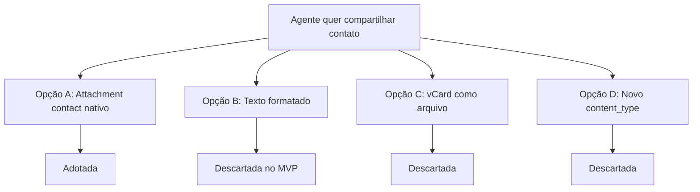
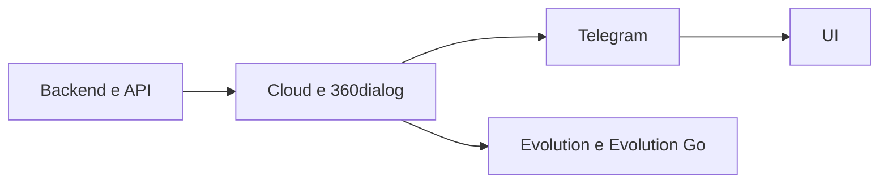

# Share Contact Card — Árvore de Decisão

Decisões do envio de contact card pelo agente. O resultado implementado está em [current-state.md](./current-state.md).

**Atualizado out/2026.**

---

## Pergunta central

> Como o agente envia um contato do CRM para o cliente na conversa?



### Opção A — `Attachment` `file_type: contact`

Reusa bubble, preview e o modelo de inbound. O cliente recebe o cartão nativo do canal. Exige telefone e um adapter por provider.

Foi a opção entregue.

### Opções B, C e D

Texto formatado ficou como fallback possível para SMS ou API no futuro. Arquivo `.vcf` e um `content_type` novo foram descartados: `file_type: contact` já é o contrato.

---

## Decisões de produto

### 1. i18n `pt_BR` na mesma entrega

Sim. Chaves em `en/conversation.json` e `pt_BR/conversation.json`. Os outros idiomas ficam com a comunidade.

### 2. Atalho do contato da conversa

Sim. O card fica no topo do dialog e o ComboBox continua abaixo, com o separador `OR_SEARCH`.

Implementação posterior: o card também aparece sem telefone, com `NO_PHONE_CURRENT` e link para editar o contato.

### 3. 360dialog junto com Cloud

Sim. Os dois usam `type: contacts`. O payload compartilhado está em `Whatsapp::ContactMessagePayloadBuilder`.

### 4. Echo de coexistence

Sem normalizer extra. O echo de contact que chega do app WhatsApp continua pelo inbound. Duplicata entre um envio do Chatwoot e um reencaminhamento no celular segue como follow-up, se aparecer.

### 5. Permissão — entrou depois do plano

`administrator`, `agent` ou `contact_manage`. O backend recusa com `Not authorized to share this contact` quando há usuário sem essas permissões. O botão some no mesmo caso.

### 6. Empresa — entrou depois do plano

`org.company` no WhatsApp e `organization` nos gateways, a partir de `company_name` ou da empresa ligada ao contato.

### 7. Gateways

Evolution e Evolution Go foram implementados em `custom/`. Z-API não faz parte deste fork.

---

## Canais



Fora de escopo: LINE, Facebook, Instagram, SMS e inbox API.

---

## Onde o código mora

| Prioridade | O que foi feito |
|------------|-----------------|
| `custom/` | Handler, prepend do `MessageBuilder`, capability, Evolution e Evolution Go |
| `# FORK:` mínimo | Cloud, 360dialog, Telegram, ReplyBox, preview e pending message |
| Sem feature flag | Entrega direta |

A capability é `ChannelCapabilities::ShareContact.supports?`. Ela não distingue provider: Cloud, 360dialog e os gateways são todos `Channel::Whatsapp`.

---

## Contrato da API

```json
POST /api/v1/accounts/:account_id/conversations/:id/messages
{ "shared_contact_id": 123 }
```

Não combina com arquivo, texto ou nota privada. O contato precisa de telefone E.164. O inbox precisa ser WhatsApp ou Telegram.

---

## Resumo

| Dimensão | Escolha em vigor |
|----------|------------------|
| Modelo | `Attachment` `file_type: contact` |
| API | `shared_contact_id` |
| Canais | Cloud, 360dialog, Evolution, Evolution Go, Telegram |
| UI | Dialog + ComboBox + atalho |
| Permissão | `administrator`, `agent` ou `contact_manage` |
| i18n | `en` + `pt_BR` |
| Echo | Sem normalizer extra |

→ [implementation-plan.md](./implementation-plan.md)
