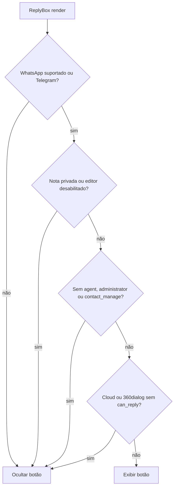

# Share Contact Card — Backlog

Itens da revisão de jun/2026, reconciliados com o código em out/2026. O estado implementado está em [current-state.md](./current-state.md).

---

## Entregue

| ID | Item | Onde ficou |
|----|------|------------|
| MVP-1 | Save Contact só no incoming | `Contact.vue` (`variant` e `isContactInfoResponse`) |
| MVP-2 | Preview "Shared contact" + ícone | `useMessagePreview.js` e os dois `MessagePreview.vue` |
| MVP-3 | Guard `can_reply` | Botão oculto em Cloud e 360dialog. Gateways não têm janela de 24h |
| MVP-4 | E.164 | Handler rejeita telefone inválido. O cliente também normaliza o pending message |
| MVP-5 | Meta snake_case no bubble | `first_name` / `last_name` como fallback |
| MVP-6 | Copy outgoing | `CONTACT_OUTGOING` |
| MVP-7 | `business_connection_id` | `SendAttachmentsService#send_contact` |
| P1-1 | Editar contato sem telefone | `NO_PHONE_CURRENT` + link `/contacts/:id` |
| P1-2 | Permissão | Backend e botão: `administrator`, `agent` ou `contact_manage` |
| P1-3 | Specs | Handler, Cloud, 360dialog, Telegram, Evolution |
| P1-4 | Analytics | `CONVERSATION_EVENTS.SHARED_CONTACT` após sucesso |
| P2-1 | `org` no WhatsApp | `meta.companyName` → `org.company` / `organization` |
| P2-4 | Evolution | `sendContact` e vCard do Evolution Go |

O botão de atalho usa `type="button"`. Dentro do `<form>` do `Dialog`, o default `submit` confirmava o dialog no mesmo clique.

---

## Estados do botão

Telegram, Evolution e Evolution Go caem em "exibir" quando permissão e editor permitem. `DISABLED_SESSION_EXPIRED` fica reservada e não aparece.

---

## Aberto

| ID | Item | Notas |
|----|------|-------|
| P2-2 | API pública e inbox API | O dashboard já manda `shared_contact_id`. Bots e `Channel::Api` continuam de fora |
| P2-3 | Echo dedup | Só se o mesmo `source_id` duplicar um contact |
| P2-5 | Feature flag por inbox | Rollout gradual |
| P2-6 | Vários telefones | A API do WhatsApp aceita N phones; o CRM manda um |
| P2-7 | Atalho de teclado | Opcional |
| P2-8 | Aviso ao compartilhar o contato da conversa | O atalho faz isso de propósito; o aviso seria para o caso acidental na busca |
| — | Z-API | Não há provider neste fork |

---

## Edge cases do payload

| Caso | Tratamento |
|------|------------|
| Nome vazio | `formatted_name` = telefone E.164 |
| Um token no nome | `first_name` preenchido, `last_name` omitido |
| Telefone inválido | `Invalid phone number` antes de salvar |
| Sem empresa | `org` omitido |
| Reply-to | Cloud e Telegram encaminham; 360dialog não inclui `context` |

---

*Integrado em [implementation-plan.md](./implementation-plan.md) e [ui-design.md](./ui-design.md).*
