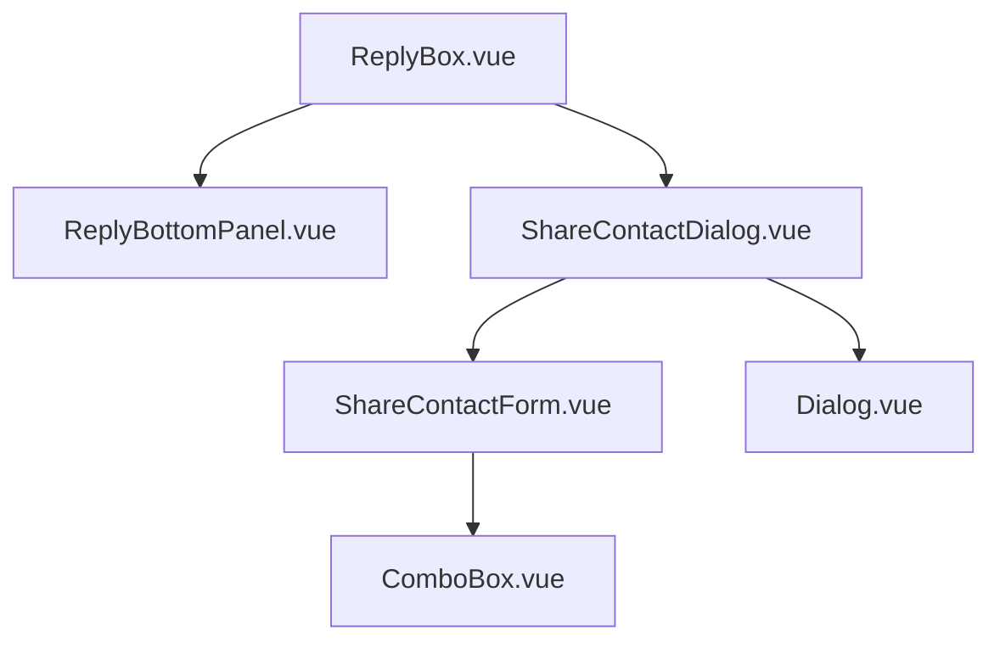

# Share Contact Card — UI

Comportamento visual do envio de contact card. O inventário de arquivos está em [current-state.md](./current-state.md).

---

## Princípios

- Tailwind only
- Composition API + `<script setup>`
- `Dialog`, `ComboBox`, `Avatar` e `Button` de `components-next`
- Feature em `widgets/conversation/ShareContact/`, acoplada ao `ReplyBox`
- Nenhuma string solta no template
- Ícone da barra: Phosphor `i-ph-address-book`

---

## Componentes



| Arquivo | Responsabilidade |
|---------|------------------|
| `ShareContactDialog.vue` | Abre e fecha o `Dialog`, emite `share` |
| `ShareContactForm.vue` | Atalho da conversa, busca e validação de telefone |
| `bubbles/Contact.vue` | Resultado no thread. Sem bubble novo |

---

## Botão na barra

`NextButton` slate, faded, sm, depois do clipe e antes da câmera.

```javascript
showShareContactButton =
  !isOnPrivateNote &&
  !isEditorDisabled &&
  hasPermissions([...ROLES, CONTACT_PERMISSIONS]) &&
  (
    isATelegramChannel ||
    isGatewayWhatsAppChannel ||
    ((isAWhatsAppCloudChannel || is360DialogWhatsAppChannel) && currentChat.can_reply)
  );
```

`isGatewayWhatsAppChannel` cobre Evolution e Evolution Go. Esses canais e o Telegram não usam a janela de 24h. Cloud e 360dialog ocultam o botão quando `can_reply` é falso.

A chave `DISABLED_SESSION_EXPIRED` permanece no i18n para um estado desabilitado futuro. A UI atual não a exibe.

---

## Dialog

`Dialog` `type="edit"`, `width="md"`, `overflow-y-auto`. Confirmar fica desabilitado sem contato selecionado e durante o envio. O shell é um `<form @submit.prevent="confirm">`: botões do corpo precisam de `type="button"`.

---

## Formulário

### Atalho

O card aparece quando a conversa tem contato (`id`), com ou sem telefone.

```
┌─────────────────────────────────────────────┐
│  Compartilhar contato desta conversa        │
│  ┌───────────────────────────────────────┐  │
│  │ [Avatar]  Nome                        │  │
│  │           +55 11 99999-9999           │  │
│  │                    [Compartilhar]     │  │
│  └───────────────────────────────────────┘  │
│            Ou buscar outro contato          │
│  [ ComboBox ]                               │
└─────────────────────────────────────────────┘
```

Sem telefone, a segunda linha é `NO_PHONE_CURRENT` e a ação vira o link `EDIT_CONTACT` para `/app/accounts/:accountId/contacts/:id` na mesma aplicação.

O botão de atalho emite `quickShare` e não dispara o confirm do dialog.

Estilo do card: `border border-n-strong rounded-xl p-3`, `Avatar` 32, nome `text-n-slate-12`, telefone `text-n-slate-11`.

### Busca

`ComboBox` com `use-api-results` e `createContactSearcher()`, debounce de 300ms. A lista fica só com quem tem `phoneNumber`.

| Resultado da busca | Empty state |
|--------------------|-------------|
| Em andamento | `IS_SEARCHING` |
| Nenhum contato | `EMPTY_STATE` |
| Só contatos sem telefone | `NO_PHONE` |

---

## Estados

| Estado | Comportamento |
|--------|----------------|
| Enviando | `Dialog` em loading; confirm desabilitado |
| Sucesso | Fecha o dialog, bolha otimista, evento `Shared a contact` |
| Erro de API | `sendMessage` já mostra o alerta; a busca usa `SHARE_CONTACT.ERROR` |
| Nota privada | Botão oculto |

O pending message em `helper/commons.js` monta um attachment `contact` com telefone normalizado e `meta.firstName` / `meta.lastName`.

---

## Bubble e lista

| Superfície | Regra |
|------------|--------|
| `Contact.vue` | Save Contact só em incoming, e nunca em `isContactInfoResponse` |
| Copy outgoing | `CONVERSATION.SHARED_ATTACHMENT.CONTACT_OUTGOING` |
| Nome | `firstName` ou `first_name`, idem sobrenome |
| Lista | `useMessagePreview.js` força o texto de attachment `contact` e o ícone `i-lucide-contact` |
| Card legado | `widgets/conversation/MessagePreview.vue` usa o mesmo composable |

---

## i18n (`en` + `pt_BR`)

`CONVERSATION.SHARE_CONTACT`: `TOOLTIP`, `ERROR`, `DISABLED_SESSION_EXPIRED` (reservada), e em `MODAL`: `TITLE`, `DESCRIPTION`, `CONFIRM`, `CANCEL`, `PLACEHOLDER`, `SEARCH_PLACEHOLDER`, `EMPTY_STATE`, `IS_SEARCHING`, `NO_PHONE`, `NO_PHONE_CURRENT`, `EDIT_CONTACT`, `QUICK_SHARE`, `OR_SEARCH`, `CURRENT_CONTACT_LABEL`.

`SHARED_ATTACHMENT.CONTACT_OUTGOING`: "You shared a contact" / "Você compartilhou um contato".

---

## Fora da UI

| Evitar | Motivo |
|--------|--------|
| Bubble novo no ReplyBox | `Contact.vue` já cobre |
| Popover como container | O fluxo precisa de confirm |
| Ícone Lucide na barra | A barra usa Phosphor |
| CSS scoped | Tailwind do projeto |
| Busca própria | `createContactSearcher` |

---

*Ver [improvements-backlog.md](./improvements-backlog.md) para o que ainda não está na UI.*
