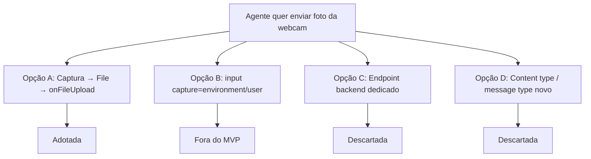
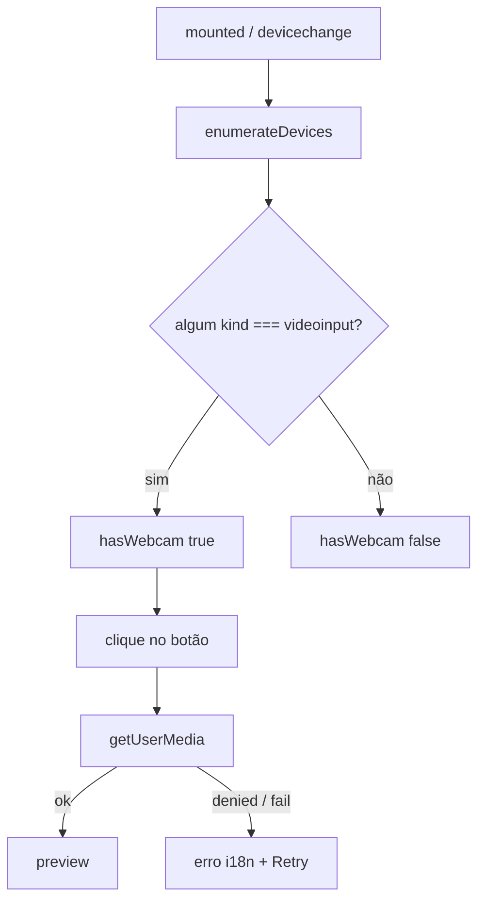

# Webcam Photo Capture — Árvore de decisão

Comparação que fechou o MVP. As decisões abaixo estão no código; ver [current-state.md](./current-state.md).

**Atualizado 24/out/2026.**

---

## Pergunta central

> Como o agente captura uma foto da webcam e envia como mensagem na conversa?

---

## Opções

### Opção A — MediaStream → `File` → pipeline de anexo

Dialog com `<video>` + `getUserMedia`, frame no canvas, `File` JPEG, `onFileUpload` como paperclip e áudio.

É a opção no ar. Zero backend, reusa DirectUpload e os limites do canal, e o hook de fork fica na toolbar.

### Opção B — `<input accept="image/*" capture="user">`

Em desktop o browser abre o file picker, não a webcam. Continua no backlog (P2-5) como fallback mobile, não como fluxo principal.

### Opção C — Endpoint de “webcam photo”

Descartada. Attachment já cobre o envio.

### Opção D — Novo `content_type`

Descartada. A imagem é attachment padrão.

---

## Decisões de produto

| # | Pergunta | Decisão |
|---|----------|---------|
| 1 | Quando mostrar o botão? | `videoinput` e (`showFileUpload` ou nota) e editor habilitado e sem gravação de áudio |
| 2 | Quando pedir permissão? | No clique, ao abrir o dialog |
| 3 | Enviar ao capturar? | Não. Capturar → Use photo anexa → o agente clica Enviar |
| 4 | Formato | `image/jpeg` qualidade `0.92`, nome `webcam-${uuid}.jpg` |
| 5 | Feature flag | Não |
| 6 | i18n | `en` + `pt_BR` na mesma entrega |
| 7 | Troca de câmera | Não. `facingMode: { ideal: 'user' }` |
| 8 | Vídeo | Fora de escopo |
| 9 | Durante gravação de áudio | Botão oculto |
| 10 | Resolução | `width/height` `ideal` 1280×720 e teto de 1920 na maior aresta |
| 11 | Permissão já negada | Botão visível; tooltip e alert, sem dialog. Negar no prompt continua no dialog, com Retry |
| 12 | Preview | `object-contain`, sem espelho. O JPEG é o frame inteiro |

---

## Decisões técnicas

| # | Pergunta | Decisão |
|---|----------|---------|
| 1 | Onde vive a lógica? | `useWebcamAvailability` e `useWebcamCapture` |
| 2 | Onde vive a UI? | `widgets/conversation/WebcamCapture/` |
| 3 | Fork | Arquivos novos + `// FORK:` em `ReplyBottomPanel` e `ReplyBox` |
| 4 | `custom/` para JS? | Não. `custom/` fica para providers |
| 5 | Ícone | `i-ph-camera` |
| 6 | Shell | `components-next/dialog/Dialog.vue` |
| 7 | Detecção | `enumerateDevices` + `devicechange`, só no `ReplyBox.setup()` |
| 8 | Secure context | Sem contexto seguro, `hasWebcam` fica falso e `startStream` devolve erro genérico |
| 9 | Footer | Cancel + Use photo. Capture, Retake e Retry no corpo |
| 10 | Corrida do prompt | `startGeneration` descarta o stream se o dialog fechou no meio do `getUserMedia` |
| 11 | Specs | Não entraram no MVP |

---

## Detecção

Antes da permissão, `label` pode vir vazio, mas a entrada `videoinput` aparece na maioria dos browsers se houver hardware. O código não chama `getUserMedia` para descobrir a câmera. Browsers que omitem `videoinput` até a primeira permissão deixam o botão oculto; isso foi aceito no MVP.

---

## Rules

| Rule | Como o MVP aplicou |
|------|--------------------|
| `fork-workflow` | Arquivos novos + hooks `FORK:` curtos |
| `architecture` | Lógica nos composables; Vue faz wiring |
| `vue-frontend` | `<script setup>`, Tailwind, i18n |
| `chatwoot-core` | `en` obrigatório e `pt_BR` porque a string é do fork |

---

*Última atualização: 24/out/2026*
