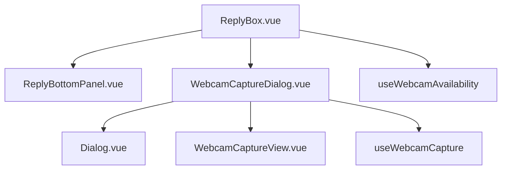

# Webcam Photo Capture — UI

Especificação alinhada ao código em `WebcamCapture/` e ao padrão do Share Contact.

---

## Princípios

- Tailwind only
- `<script setup>` nos componentes novos
- `Dialog` e `NextButton` de `components-next`
- Nenhuma string bare — chaves `CONVERSATION.WEBCAM_CAPTURE`
- Ícone da toolbar: `i-ph-camera`

---

## Componentes



`useWebcamAvailability` só no `ReplyBox.setup()`. O dialog chama `useWebcamCapture`. O BottomPanel não detecta device.

| Arquivo | Responsabilidade |
|---------|------------------|
| `composables/useWebcamAvailability.js` | `hasWebcam`, `refreshDevices`, `devicechange` |
| `composables/useWebcamCapture.js` | stream, capture, retake, erros, object URL |
| `WebcamCapture/WebcamCaptureDialog.vue` | shell do `Dialog`, emite `capture` e `devicesGranted` |
| `WebcamCapture/WebcamCaptureView.vue` | `<video>` / ``, Capture, Retake, Retry |

A foto anexada usa o preview de attachment que já existe. Não há bubble novo.

---

## Toolbar

Depois do share contact, antes do microfone:

```vue
<!-- FORK: webcam photo capture -->
<NextButton
  v-if="showWebcamButton"
  v-tooltip.top-end="$t('CONVERSATION.WEBCAM_CAPTURE.TOOLTIP')"
  icon="i-ph-camera"
  slate
  faded
  sm
  @click="$emit('openWebcamCapture')"
/>
```

| Nome | Tipo | Origem |
|------|------|--------|
| `showWebcamButton` | Boolean | `ReplyBox` |
| `openWebcamCapture` | emit | abre o dialog |

---

## Dialog

`Dialog` `type="edit"` `width="lg"`. Título e descrição vêm do i18n. Confirm = Use photo, desabilitado sem arquivo. Cancel fecha e chama `reset()`.

```
┌─────────────────────────────────────────┐
│  Tirar uma foto                      ✕  │
│  Capture uma imagem da webcam…          │
│                                         │
│  ┌───────────────────────────────────┐  │
│  │         video / img / erro        │  │
│  └───────────────────────────────────┘  │
│                                         │
│            [ Capturar | Tirar de novo ] │
│                                         │
│  [ Cancelar ]              [ Usar foto ]│
└─────────────────────────────────────────┘
```

Capture, Retake e Retry ficam no corpo, centralizados. Use photo e Cancel ficam no footer do `Dialog`.

### Estados da view

| Estado | UI |
|--------|----|
| `isStarting` sem stream, sem arquivo e sem erro | `Spinner` + “Iniciando câmera…” |
| stream pronto | `<video autoplay playsinline muted>` + Capture |
| vídeo ainda sem frame apresentado | Capture `disabled` |
| arquivo capturado | `` `object-cover` + Retake; confirm habilitado |
| `error` sem arquivo | texto `text-n-ruby-11` + Retry |

Área de mídia: `aspect-video`, `rounded-lg`, `bg-n-solid-3`, `object-contain`. Sem `scale-x-[-1]`. A faixa da caixa 16:9 mostra o fundo quando o sensor não é 16:9.

### Comportamento

1. `open()` → `reset()` → `dialog.open()` → `nextTick` → `getUserMedia`.
2. Stream ok → emit `devicesGranted` (ReplyBox refresca `enumerateDevices`).
3. Capture disabled até `loadeddata` e, se existir, `requestVideoFrameCallback`, com `videoWidth` e `videoHeight`.
4. Capture → `drawImage` no frame inteiro, reduzido se alguma aresta passa de 1920 → `toBlob('image/jpeg', 0.92)` → `File`. Frame vazio, contexto nulo ou blob nulo viram `ERROR.GENERIC` e param o stream. Os botões do corpo são `type="button"` para não submeter o form do `Dialog`.
5. Ao capturar, `stopStream()` (LED apaga). Retake limpa o preview e reabre o stream.
6. Use photo → `emit('capture', file)` → `close()` → `@close` → `reset()`.
7. Close, Cancel e unmount sempre `reset()` (tracks + `URL.revokeObjectURL`).

---

## ReplyBox

```js
showWebcamButton() {
  if (this.isEditorDisabled || this.isRecordingAudio) return false;
  if (!this.hasWebcam) return false;
  return this.showFileUpload || this.isOnPrivateNote;
},
onWebcamPhotoCaptured(file) {
  if (!file) return;
  this.onFileUpload({
    name: file.name,
    type: file.type,
    size: file.size,
    file,
  });
},
```

```vue
<WebcamCaptureDialog
  ref="webcamCaptureDialog"
  @capture="onWebcamPhotoCaptured"
  @devices-granted="refreshWebcamDevices"
/>
```

---

## i18n

`en/conversation.json` e `pt_BR/conversation.json`, chave `CONVERSATION.WEBCAM_CAPTURE`.

| Chave | en | pt_BR |
|-------|----|-------|
| `TOOLTIP` | Take a photo | Tirar uma foto |
| `MODAL.TITLE` | Take a photo | Tirar uma foto |
| `MODAL.DESCRIPTION` | Capture an image from your webcam to attach to this conversation. | Capture uma imagem da webcam para anexar a esta conversa. |
| `MODAL.STARTING` | Starting camera… | Iniciando câmera… |
| `MODAL.CAPTURE` | Capture | Capturar |
| `MODAL.RETAKE` | Retake | Tirar de novo |
| `MODAL.RETRY` | Try again | Tentar de novo |
| `MODAL.CONFIRM` | Use photo | Usar foto |
| `MODAL.CANCEL` | Cancel | Cancelar |
| `ERROR.PERMISSION` | Camera permission was denied… | A permissão da câmera foi negada… |
| `ERROR.NOT_FOUND` | No camera was found on this device. | Nenhuma câmera foi encontrada neste dispositivo. |
| `ERROR.GENERIC` | Could not open the camera… | Não foi possível abrir a câmera… |

---

## Acessibilidade

- Tooltip no botão da toolbar
- `playsinline` e `muted` no `<video>`
- `` no preview capturado (a ação seguinte tem label i18n)
- O editor do ReplyBox continua utilizável com o dialog fechado

Foco automático no Capture/Confirm não está implementado.

---

## Fora do escopo visual

- Seletor de câmera
- Espelho só no preview
- Crop, filtros, flash, timer
- Gravação de vídeo
- Atalho de teclado

---

*Última atualização: 24/out/2026 (tarde)*
